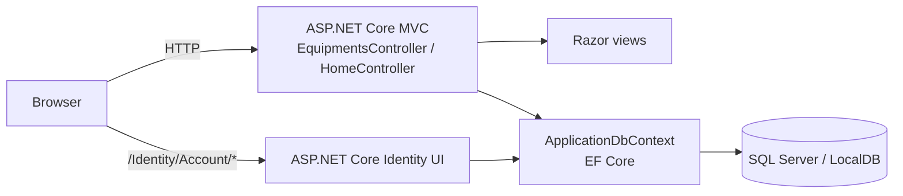

# AgriTech Demo

A small ASP.NET Core MVC app for keeping an inventory of farm equipment, with SQL Server storage and user accounts.


## Overview

AgriTech Demo is a personal practice project for the core ASP.NET Core MVC workflow: a model, an Entity Framework Core `DbContext`, code-first migrations against SQL Server, a controller with full create/read/update/delete actions, Razor views, and ASP.NET Core Identity for sign-in. The domain is a farm equipment register. Each item records its name, type, description, cost, purchase date, manufacturer, model number, and whether it is currently operational.

## Key features

- **Equipment inventory (CRUD).** List, view details, add, edit and delete equipment records.
- **User accounts.** Register, log in and log out with ASP.NET Core Identity (default Identity UI). Accounts must be confirmed before first sign-in.
- **Protected pages.** The Create, Edit and Delete pages require a signed-in user; anyone can browse the list and details.
- **Server-side validation and anti-forgery protection** on all form posts, with jQuery unobtrusive validation on the client.
- **Code-first database** managed with EF Core migrations (Identity schema plus an `Equipment` table).
- **Responsive layout** using Bootstrap, with custom styles for the equipment pages.

## How it works



`Program.cs` registers `ApplicationDbContext` with the SQL Server provider using the `DefaultConnection` connection string, adds Identity and MVC, and maps the default `{controller=Home}/{action=Index}/{id?}` route. `EquipmentsController` runs async EF Core queries and passes `Equipment` models to the Razor views in `Views/Equipments/`.

## Tech stack

| Layer | Technology |
| --- | --- |
| Framework | ASP.NET Core MVC on .NET 8, C# |
| Data | Entity Framework Core 8 (SQL Server provider), code-first migrations |
| Auth | ASP.NET Core Identity with the default Identity UI |
| Front end | Razor views, Bootstrap, jQuery validation |
| Database | SQL Server (LocalDB by default) |

## Project structure

```text
.
├── Controllers/        # EquipmentsController (CRUD), HomeController
├── Models/             # Equipment, ErrorViewModel
├── Data/
│   ├── ApplicationDbContext.cs
│   └── Migrations/     # Identity schema and Equipment table migrations
├── Views/              # Razor views (Equipments, Home, Shared layout)
├── Areas/Identity/     # Identity UI configuration
├── wwwroot/            # CSS, JS, Bootstrap/jQuery libraries
├── Program.cs          # service registration and request pipeline
├── appsettings.json    # ConnectionStrings:DefaultConnection
└── AgriTech1.sln
```

## Getting started

**Prerequisites:** [.NET 8 SDK](https://dotnet.microsoft.com/download) and SQL Server. The default configuration uses SQL Server Express LocalDB, which installs with Visual Studio on Windows.

```bash
# 1. Restore packages
dotnet restore

# 2. Install the EF Core CLI if you don't have it
dotnet tool install --global dotnet-ef

# 3. Create the database from the migrations
dotnet ef database update

# 4. Run the app
dotnet run
```

Open the URL shown in the console (by default `http://localhost:5142`, or `https://localhost:7246` with the `https` launch profile), choose **Equipments** in the navigation bar, and register an account to add or edit equipment.

### Configuration

| Name | Purpose |
| --- | --- |
| `ConnectionStrings:DefaultConnection` | SQL Server connection string, set in `appsettings.json`. The app fails at startup if it is missing. |

To use a different SQL Server without editing `appsettings.json`, override the setting with an environment variable or with .NET user secrets (the project already has a `UserSecretsId`):

```bash
# Environment variable
export ConnectionStrings__DefaultConnection="Server=localhost;Database=AgriTech;Trusted_Connection=True;TrustServerCertificate=True"

# or user secrets
dotnet user-secrets set "ConnectionStrings:DefaultConnection" "<your connection string>"
```

## Author

**Riyaj Chaulagain**, Computer Science student at Southeastern Louisiana University

- GitHub: [riyajclgn123](https://github.com/riyajclgn123)
- Portfolio: [riyajchaulagain.com.np](https://riyajchaulagain.com.np)
